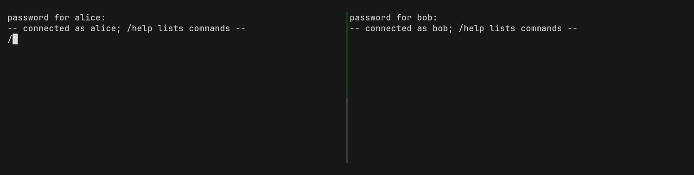
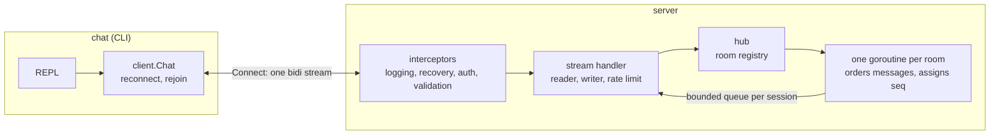

# go-grpc-chat

A chat server in Go on gRPC bidirectional streaming, with rooms, JWT
authentication and a terminal client that survives reconnects.



- One long-lived stream per client carries joins, leaves, messages and
  replies; each room orders its messages and numbers them with `seq`.
- A slow reader never stalls a room: every session has a bounded queue,
  and a client that falls behind is dropped with `SLOW_CLIENT` and
  reconnects.
- Graceful shutdown, keepalive, message size and rate limits, request
  validation from the `.proto` contract, structured logs.
- Optional TLS on the server; the client refuses plaintext to anything but
  loopback.
- A distroless image that runs as non-root, with a health check that works
  with and without TLS.

## Quick start

Requirements: Docker, Go 1.27 and GNU make.

```
make up        # server (and Postgres for later) in Docker, waits until healthy
make build     # builds bin/chat
bin/chat register -user alice
bin/chat -user alice
```

Run `bin/chat -user bob` in a second terminal and `/join general` in both;
`/help` lists the commands. On Windows the binary is `bin\chat.exe`.

With TLS, on development certificates:

```
make up-tls    # writes certs/ on first use
bin/chat -user alice -ca certs/ca.pem
```

`make run` starts the server without Docker.
[docs/manual-testing.md](docs/manual-testing.md) walks through both clients
and the raw API with grpcurl.

## How it works



The stream handler reads requests on one goroutine and writes events on
another; the room goroutine never waits for a client. The reasoning behind
each part is in the ADRs:

| ADR | Decision |
|---|---|
| [0001](docs/adr/0001-project-layout.md) | Layout: thin `cmd/`, everything in `internal/` |
| [0002](docs/adr/0002-testing-with-stdlib-and-go-cmp.md) | Tests: stdlib `testing`, go-cmp, hand-written fakes |
| [0003](docs/adr/0003-chat-stream-protocol.md) | The chat protocol: one stream, request ids, `seq`, error reasons |
| [0004](docs/adr/0004-generated-code-is-committed.md) | Generated code is committed |
| [0005](docs/adr/0005-password-normalization.md) | Password normalization |
| [0006](docs/adr/0006-server-lifecycle-and-transport.md) | Shutdown, keepalive and transport limits |
| [0007](docs/adr/0007-authentication.md) | bcrypt, JWT, auth interceptors |
| [0008](docs/adr/0008-chat-hub-registry-and-rooms.md) | Hub, room goroutines, queues, rate limit |
| [0009](docs/adr/0009-chat-stream-handler.md) | The stream handler's goroutines |
| [0010](docs/adr/0010-cli-client.md) | The CLI client and its reconnects |
| [0011](docs/adr/0011-scaling.md) | Why one instance, and what several would take |
| [0012](docs/adr/0012-packaging-and-tls.md) | Image, health check, TLS |

## Testing

`make check` runs the linter, contract checks, the race detector (in
Docker) and a vulnerability scan; CI runs the same.

- Client tests run against the real server, assembled exactly as
  `cmd/server` assembles it, over an in-memory listener; hand-written
  servers cover the failures the real one does not produce on demand.
- Concurrency in the hub and the stream handler is tested in
  `testing/synctest` bubbles, under `goleak` and `-race`.
- The CLI is tested as whole terminal sessions through pipes.

## Limitations

- One instance only: rooms live in the process's memory (ADR-0011).
- Accounts and messages are kept in memory and lost on restart; a room's
  `seq` starts again from 1 when it empties.
- Messages sent while a client is reconnecting are lost to it.
- Incoming messages can break up a half-typed line on the screen; the
  line itself is not affected.
- In the classic Windows console, a QuickEdit selection pauses the client.

## Status

Working: registration and login, rooms, messaging, reconnects with rejoin,
token expiry and re-login, per-user rate limit, TLS, the container image
and the demo above.

Next: PostgreSQL storage for accounts and messages, with `seq` allocated
in the database and history through `ListMessages`; then metrics and
tracing.

## License

[MIT](LICENSE)
